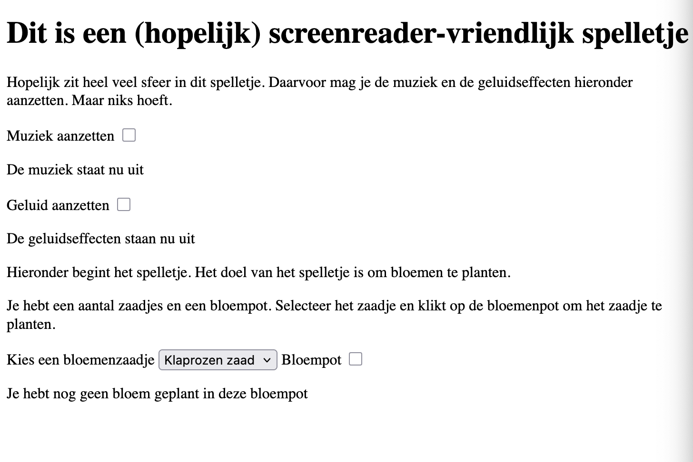
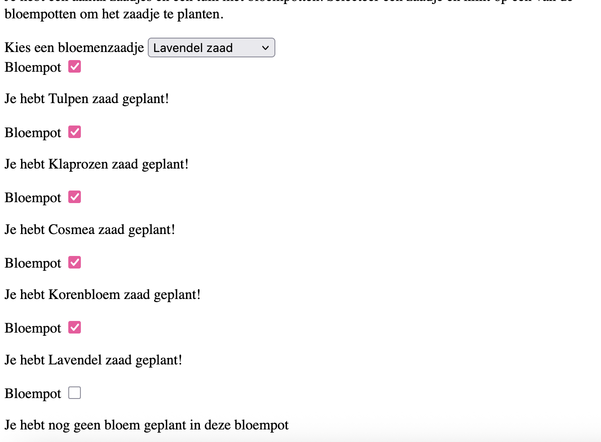

# Human Centered Design
## Een screenreader-vriendelijk tuinspel voor Ihab

## 1. Het project

### Hoe maak je een website voor één persoon met één specifieke beperking?

Ik moest een gepersonaliseerde website maken voor Ihab, een blind persoon die een screenreader gebruikt.
Hij loopt niet echt ergens tegenaan op het web, behalve als websites slecht gemaakt zijn. Er leek dus geen duidelijk probleem te zijn dat ik door een prototype voor hem kon oplossen, dus ik besloot om een website te maken die een spelletje is.
Het werkt voor hem, het lost niks op maar het levert ook geen problemen op. En in het beste geval is het ook nog leuk om te spelen.
De perfecte oplossing voor de opdracht dus!

**Mijn concept:** een tuinspel waarin Ihab bloemen kan planten en verzorgen. Niet gericht op het oplossen van een praktisch probleem, maar op een leuke ervaring met een screenreader.

## 2. Onderzoek en ontwerpkeuze

### Wat ik leerde uit het interview met Ihab

Ihab gebruikt Windows en de screenreaders JAWS en NVDA. Hij is ervaren met toetsenbordnavigatie en gebruikt vrijwel geen muis. Tijdens het interview werd duidelijk dat hij niet per se meer hulpmiddelen nodig heeft: hij wil vooral dat websites goed functioneren.

De belangrijkste inzichten voor mijn ontwerp waren:

- **Bestaande navigatie werkt voor hem.** Hij kan al tussen koppen, links en knoppen springen. Extra sneltoetsen of een speciaal navigatiemenu voegen voor hem niet vanzelfsprekend iets toe.
- **Duidelijke labels en overzicht zijn belangrijk.** Bij ontoegankelijke websites ontbreekt vaak een duidelijk beeld van wat er op de pagina staat en wat de onderdelen doen.
- **Een screenreader brengt weinig sfeer over.** Bij noodzakelijke taken mist hij die sfeer niet echt. Bij persoonlijke websites, verhalen of iets voor plezier kan sfeer wel iets toevoegen.
- **Geluid moet een keuze zijn.** Geluiden kunnen leuk zijn, maar ook irritant worden. Hij wil ze zelf kunnen aan- en uitzetten, zonder dat ze de screenreader in de weg zitten.

### Waarom een spel?

Eigenlijk zijn de meeste van de opdrachten die Berend, een andere blinde opdrachtgever, heeft bedacht niet echt van toepassing voor Ihab. Ihab zei bij heel veel opdrachten, zoals een library van sneltoetsen maken, dat dat niet echt nodig was omdat je het ook gewoon kunt googelen. Verder zei hij dat hij niet echt met extensies werkt omdat hij goed genoeg kan omgaan met zijn screenreader en dat hij ook niet echt behoefte heeft aan extra functionaliteiten omdat alles wat al bestaat al goed genoeg is.

Hij zei dat de screenreader wel heel eentonig is en de sfeer van een website niet goed weergegeven kan worden. Maar hij zei ook dat hij dat niet vaak mist, behalve op social media waar het om persoonlijke verhalen gaat. Maar ook persoonlijke websites en producten die je wilt kopen zouden fijner zijn als ze wat meer sfeervol omschreven worden.

Maar omdat hij dus eigenlijk geen behoefte heeft aan praktische dingen en alleen sfeer wil voor dingen die niet belangrijk zijn om te bedienen, wil ik iets onbelangrijks en onpraktisch maken: een spel! Maar dan screenreader-friendly.

### Onderzoek naar bestaande spellen

Ik heb Stardew Valley met een mod voor blinde spelers geïnstalleerd en uitgeprobeerd. Tijdens het spelen vond ik het lastig dat er bij veel bewegingen niets werd gezegd. Dat bracht me op het idee om een kleiner spel te maken waarin duidelijk wordt uitgelegd wat er gebeurt.

Ik wilde eerst één functionaliteit goed uitwerken en testen, in plaats van meteen een groot spel te bouwen.

## 3. Eerste prototype en test

In mijn eerste prototype kon Ihab uit drie zaden kiezen en deze vervolgens in een bloempot planten. Daarnaast had ik een knop toegevoegd voor muziek en geluidseffecten.

### Wat ik wilde testen

- Is het duidelijk dat de website een spel is?
- Zijn een select en checkboxes prettig te gebruiken met zijn screenreader?
- Zijn de handelingen en geluidseffecten duidelijk?

### Wat de test opleverde

Ihab vond de select en checkboxes duidelijk. De geluidseffecten waren niet meteen duidelijk, dus die moest ik beter uitleggen. Hij vond het concept leuk, maar wilde dat ik het verder uitwerkte en echt interactief maakte.

Hij stelde voor om een hele tuin te maken, aan te geven wanneer planten water nodig hebben en bloemen in hun verschillende groeistadia te beschrijven. Ook wilde hij een overzicht van alle geplante bloemen. Daarnaast noemde hij het tonen van de tijd sinds het planten en een mogelijkheid om nieuwe bloemen te maken.

Rondlopen door de tuin leek hem niet per se nodig. Daardoor kon ik me richten op het planten, verzorgen en bekijken van bloemen, zonder ruimtelijke navigatie toe te voegen.

Ik werkte het prototype vervolgens uit naar meerdere bloempotten waarin verschillende bloemen geplant konden worden.

## 4. Structuur en toegankelijkheid

### Feedback van Jules Ernst

Op de Smashing Conference heb ik mijn website laten zien aan toegankelijkheidsexpert Jules Ernst. Met hem keek ik vooral naar de structuur van de pagina en naar wat er gebeurt wanneer onderdelen veranderen.

Zijn belangrijkste aandachtspunten waren:

- Een logische volgorde van koppen en secties voor iemand die de pagina met een screenreader verkent.
- Overbodige ARIA-attributen vermijden.
- Veranderingen in de tuin duidelijk terugkoppelen, zonder een onoverzichtelijke hoeveelheid losse meldingen.
- Vanuit het overzicht terug kunnen navigeren naar de relevante onderdelen.
- Onderzoeken of **tuinieren** en **de tuin bekijken** beter aparte onderdelen kunnen zijn.

### Mijn ontwerpkeuze

Ik maakte een aparte tuin- en tuiniersectie. Daarbij behield ik ook mijn eerdere ontwerp, zodat ik Ihab kon vragen welke opzet hij prettiger vond. Ik wilde de keuze niet alleen baseren op wat mij logisch leek.

De volgende test richtte ik op de indeling, de beschikbare keuzes, het verspringen van de focus en de manier waarop Ihab veranderingen in de tuin opmerkt.

## 5. Tweede test en verbeteringen

De interactie met de bloempot werkte volgens Ihab goed. Ook het verspringen van de focus vond hij prettig. Tegelijkertijd bracht deze test concrete verbeterpunten en een bug aan het licht.

| Bevinding uit de test | Wat ik ermee deed |
| --- | --- |
| In de test werden disabled knoppen niet voorgelezen. Een select met maar één optie vond Ihab vreemd. | Ik nam dit mee als aandachtspunt voor het aanbieden van keuzes en beschikbare acties. |
| Ihab wilde onkruid ook kunnen laten groeien. | Ik voegde onkruid water geven toe als interactie. |
| Hij wilde op meer plekken geluidseffecten horen. | Ik voegde meer geluidseffecten toe. |
| De overzichtstabel bood informatie, maar geen interactie. | Ik voegde links toe om vanuit de tabel terug te gaan naar het bewerken van een bloembed. |
| De tuinbeschrijving bleef zeggen dat de tuin leeg was. | Ik liet de beschrijving aanpassen wanneer er bloemen worden geplant. |
| Bij het wisselen tussen bloembedden bleef soms de verkeerde actie beschikbaar. | Ik herschreef de logica, zodat de acties passen bij de toestand van het geselecteerde bloembed. |

### Een technische uitdaging

De bugfix duurde langer dan ik had verwacht. Wanneer ik wisselde van een bloembed met onkruid naar een bloembed waarin het onkruid al gewied was, bleef onkruid verwijderen soms de enige optie.

Om dit op te lossen moest ik mijn code grotendeels opnieuw structureren. De beschikbare acties moesten steeds passen bij de toestand van het gekozen bloembed, ook met extra toestanden zoals ‘bloem geplant’ en ‘onkruid water gegeven’. Niet alleen de actie zelf moest werken: ook na het veranderen van de select moest de juiste informatie worden getoond.

## 6. Het resultaat

Mijn tuinspel is opgebouwd rond wat Ihab tijdens de tests duidelijk en leuk vond. Hij kan meerdere bloembedden beheren, bloemen planten en verzorgen, en kiezen om onkruid water te geven in plaats van het meteen te verwijderen.

De tuinbeschrijving verandert mee wanneer er bloemen worden geplant. De overzichtstabel bevat links om terug te gaan naar het bewerken van een bloembed. Geluidseffecten voegen sfeer toe, terwijl de bediening aansluit op zijn gebruik van een screenreader.

**Mijn proces in het kort:** onderzoeken wat voor Ihab iets toevoegt, klein beginnen, testen en zijn feedback vertalen naar concrete aanpassingen.

## 7. Eindreflectie - Toepassen van "Exclusive Design Principles"

### Add Nonsense

Ik ben tijdens dit project eigenlijk voornamelijk bezig geweest met “Add Nonsense”. Ik vond het erg lastig om te bedenken wat ik voor Ihab moest maken, omdat hij alle dingen die “nuttig” waren afkeurde. Een extensie? Zou hij niet gebruiken. Een overzicht van shortcuts? Die kun je gewoon googelen. Dus het voelde niet echt nodig om iets te maken wat “nuttig” is.

Daarom besloot ik om iets te maken wat sowieso niet nuttig hoeft te zijn: een spelletje! En ik ben daarin nog verder gegaan. Ook mijn vormgeving is “nonsense”. Ik heb een helemaal zwart scherm gemaakt, want Ihab kan toch niet zien, en de website is alleen voor hem bedoeld.

### Study Situation

Ik heb onderzoek gedaan naar spellen voor blinde mensen, door zelf het spel “Stardew Valley” met een mod voor blinde mensen te spelen. En eigenlijk vond ik helemaal niet zo fijn hoe dat werkte, omdat er bij heel veel bewegingen gewoon niks werd gezegd. Dus ik wilde een spel maken waar je elke stap uitgelegd krijgt. En dit heb ik getest met Ihab: het moest voor hem werken en niet voor mij.

Hij gaf aan dat hij meer interactie wilde met het onkruid, dus dat heb ik toegevoegd. Hij gaf aan dat hij een overzicht van de hele tuin wilde, dus dat heb ik toegevoegd. Eigenlijk is alles in mijn spel op Ihab afgestemd. En ik denk dat het ook vooral werkt, omdat hij heel goed kan omgaan met screenreaders.

Het lijkt mij dat dit spel ook heel verwarrend zou kunnen zijn voor iemand die minder goed met screenreaders kan omgaan. Maar daarvoor moest ik niet ontwerpen. Ik moest voor Ihab, een screenreader-pro ontwerpen, dus ik heb het ingewikkeld gemaakt maar het werkt ook gewoon! Hij vindt het leuk, hij snapte alle interacties en hij moest zelfs een beetje om mijn spel lachen. Ik vind dat mijn spel heel goed bij mijn situation past: screenreader-pro Ihab!

### Ignore Conventions

Er zijn niet echt conventies voor spellen voor blinde mensen, dus eigenlijk kon ik alles wat ik wist gewoon negeren. Hoe laat je zien dat je in een tuin bent? Hoe omschrijf je verschillende bloemen? Hoe zorg je ervoor dat je bloemen kunt planten, verwijderen en water geven? Hier bestaan geen conventies voor, dus ik heb maar gewoon mijn best gedaan om iets te bedenken met behulp van selects en checkboxes. En het blijkt te werken! Ihab snapte meteen wat hij moest doen.

Jules Ernst zei tijdens mijn test met hem dat hij zich meteen zorgen maakte, omdat ik zoveel dingen liet verschijnen en verdwijnen, en dat er meteen alarmbelletjes bij hem afgingen qua toegankelijkheid. Maar ja, met een spel moet dat wel gebeuren. Dus ik heb het toch maar gedaan, en het blijkt allemaal goed te werken.

### Prioritize Identity

Prioritize Identity gaat voor mij met heel veel dingen samen die ik hierboven al heb genoemd. Ihab is een screenreader-pro, dus ik kon de interactie wel redelijk ingewikkeld maken en het toch laten werken. Zijn identiteit maakt mijn spel ingewikkelder dan ik het zou maken voor een persoon die minder goed kan omgaan met screenreaders.

Hij kan heel goed navigeren tussen verschillende sections en omgaan met selects en checkboxes, en hij snapt wat er gebeurt als de focus verspringt, dus dit waren allemaal dingen waarmee ik kon werken. En de functionaliteiten zijn dus ook op zijn identiteit afgestemd. Hij wilde het onkruid graag water geven en niet meteen verwijderen, dus dat kan hij nu doen. Hij heeft geen vormgeving nodig, dus er is nu geen vormgeving. De website werkt goed voor Ihab, en ook alleen voor Ihab!

